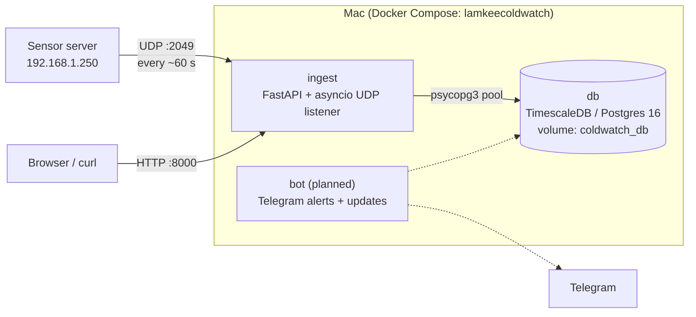
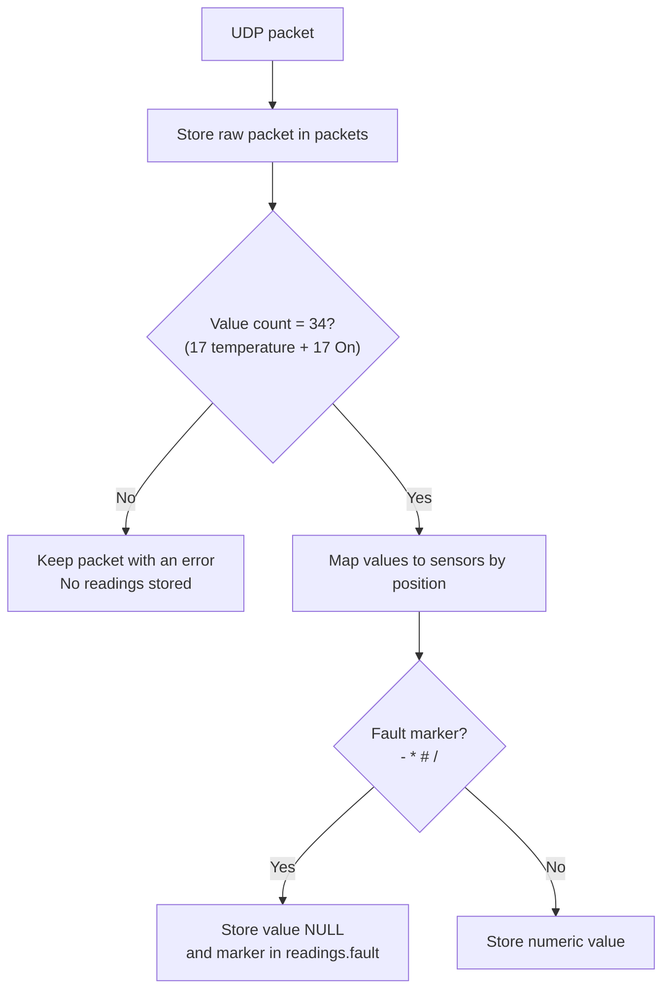
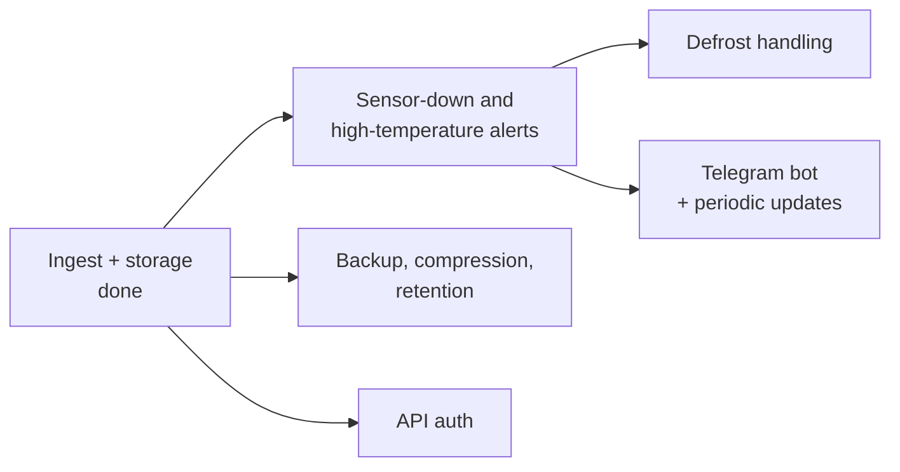

# LamkeeColdwatch

Monitoring for 17 coldrooms and freezers. A sensor server pushes readings over UDP about once a minute. They are stored in TimescaleDB. The aim is to alert when a sensor is down or a room is too warm, and to send periodic updates through a Telegram bot.

## Status

| Area | State |
| --- | --- |
| UDP ingest (all 17 rooms, temperature + "On") | Working, 49 regression tests |
| TimescaleDB storage | Working |
| Editable room names | Working (`PUT /rooms/{code}`) |
| Auto-restart after power loss | Working (`restart: unless-stopped`) |
| Sensor-down detection, high-temperature alerts, defrost handling | Not built |
| Telegram bot | Not built |
| Backup, compression, retention | Not configured |
| Auth on the HTTP API | Not built |

## Architecture



Dashed lines are planned and not built yet.

## How a packet is handled



## Packet format

```
LamkeeColdwatch,<count>,<YYYY-MM-DD HH:MM:SS>,<v1..vN>,<status>
```

- Values 0-16 are temperatures and 17-33 are the matching "On" flags, for 17 rooms.
- Identity is positional. The `sensors` table maps each position to a room.
- Docker Desktop rewrites the UDP source address, so the stored `client` isn't the real sender.

## Rooms

Codes run from `RS1-001` to `RS1-022` (17 in use, with gaps at 016-019 and 021). Names are editable at any time:

```
curl -X PUT http://localhost:8000/rooms/RS1-001 -H 'Content-Type: application/json' -d '{"label": "Room 1"}'
```

`GET /rooms` lists every room with its device name, custom label and display name. Send an empty label to clear it.

## Getting started

1. Copy `.env.example` to `.env` and set the database password.
2. Start the stack:
   ```
   docker compose up -d
   ```
3. Point the sensor server's push target at `<this Mac's IP>:2049` (UDP).

### Configuration

| Variable | Default | Purpose |
| --- | --- | --- |
| `INGEST_BIND_IP` | `0.0.0.0` | Host interface the ports bind to |
| `INGEST_PORT` | `8000` | HTTP port |
| `UDP_PORT` | `2049` | UDP port the sensor server pushes to |

The ingest listens on all interfaces and stores no IP of its own. If the Mac's IP changes, update only the push target on the sensor server. After editing `.env`, run `docker compose up -d`.

## Tests

```
tests/.venv/bin/pytest tests -q
```

The stack must be running. Tests use the identifier `RegressionTest` and year-2000 timestamps, and clean up after themselves.

## Project layout

```
docker-compose.yml     db + ingest services
db/init/               schema SQL (runs only on an empty volume)
ingest/app/udp.py      packet parsing, storage, UDP protocol
ingest/app/main.py     HTTP routes
tests/test_ingest.py   regression tests
AGENTS.md              guidance for AI coding agents
```

## Known limitations

- HTTP port 8000 has no authentication. Keep it on the LAN.
- No backup, compression or retention yet. Data lives in the `coldwatch_db` Docker volume.
- `raw_requests` and `POST /readings` are legacy.
- `sensors.high_threshold` exists but isn't used yet.

## Roadmap



Open questions: which rooms are freezers or chillers and their thresholds, the sensor-down timeout, the meaning of the status code and fault markers, and the sensor server's timezone.
