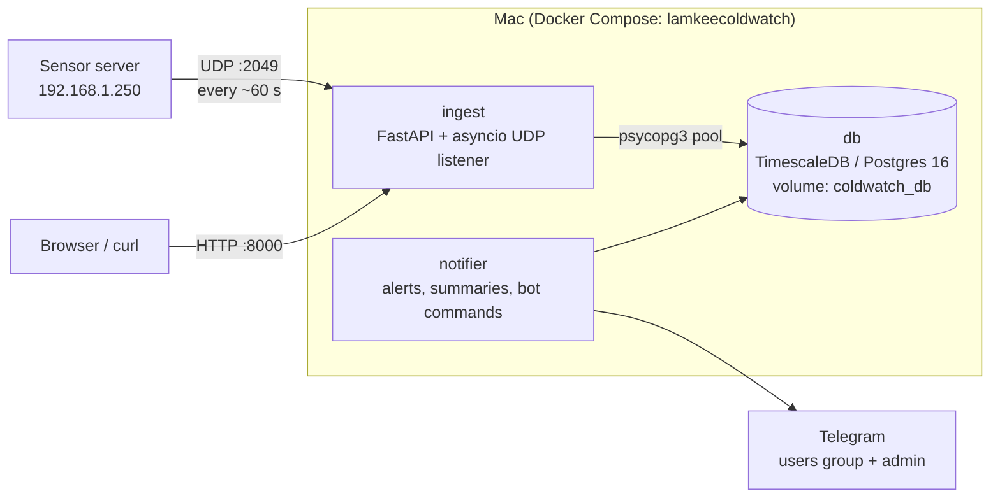
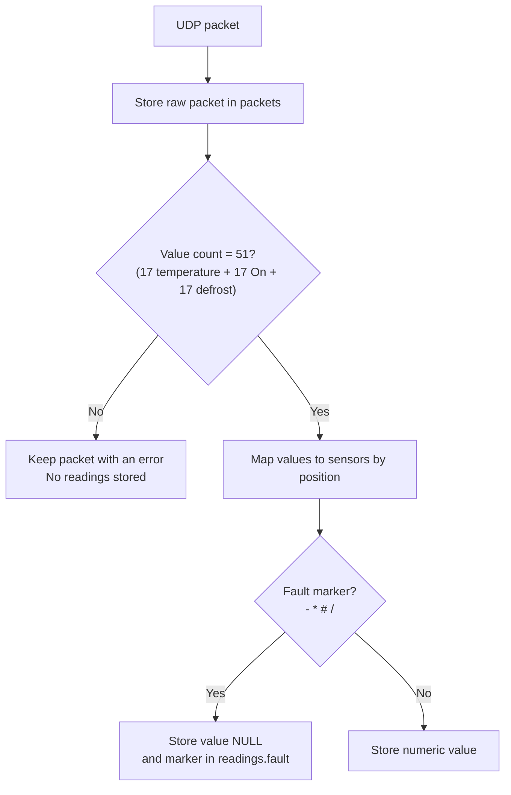
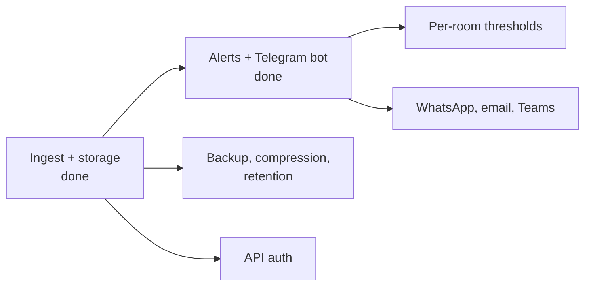

# LamkeeColdwatch

Monitoring for 17 coldrooms and freezers. A sensor server pushes readings over UDP about once a minute. They are stored in TimescaleDB. A Telegram bot alerts when a room is too warm, has no reading or its unit is off, sends summaries at 07:00 and 20:00 (Asia/Singapore) and answers /status, /room, /alerts and /help.

## Status

| Area | State |
| --- | --- |
| UDP ingest (all 17 rooms, temperature, "On" and defrost) | Working, regression tests |
| TimescaleDB storage | Working |
| Editable room names | Working (`PUT /rooms/{code}`) |
| Auto-restart after power loss | Working (`restart: unless-stopped`) |
| Alerts: too warm, no reading, unit off, recovered | Working (`notifier`) |
| Telegram summaries and slash commands | Working |
| Defrost tracking (pauses BAD alerts) | Working, defrost value 1 = active unconfirmed |
| Backup, compression, retention | Not configured |
| Auth on the HTTP API | Not built |

## Architecture



## How a packet is handled



## Packet format

```
LamkeeColdwatch,<count>,<YYYY-MM-DD HH:MM:SS>,<v1..vN>,<status>
```

- Values 0-16 are temperatures, 17-33 are the matching "On" flags and 34-50 are defrost flags, for 17 rooms.
- Identity is positional. The `sensors` table maps each position to a room.
- Docker Desktop rewrites the UDP source address, so the stored `client` isn't the real sender.

## Rooms

Codes run from `RS1-001` to `RS1-022` (17 in use, with gaps at 016-019 and 021). Names are editable at any time:

```
curl -X PUT http://localhost:8000/rooms/RS1-001 -H 'Content-Type: application/json' -d '{"label": "Room 1"}'
```

`GET /rooms` lists every room with its device name, custom label and display name. Send an empty label to clear it.

## Alerts

Thresholds are shared by all rooms (table `alert_config`).

| Alert | When | Icon |
| --- | --- | --- |
| BAD | Warmer than -12°C for 120 min in a row. STILL BAD repeats every 15 min | ❗ |
| CRITICAL | No reading for 5 min, or the unit is off (immediate). STILL CRITICAL repeats hourly | ❌ / 🔁 |
| RECOVERED | The problem is over, with how long it lasted | ✅ |

- Room alerts pause during a defrost and while no sensor sends data.
- The notifier waits 3 min after starting before alerting.

Who gets what:

| Alert | Users group | Admin |
| --- | --- | --- |
| Too warm (BAD, STILL BAD) | yes | yes |
| Unit off | yes | yes |
| No reading from a room | no | yes |
| Summaries | yes | yes |
| Notifier restarted | no | yes |

A room with no reading plus a unit off or too warm problem goes to both. To mute the users group while fixing a fault, set `pause_users` to `1` in the `alert_meta` table. Admin still receives everything.

## Getting started

1. Copy `.env.example` to `.env` and set the database password.
2. Start the stack:
   ```
   docker compose up -d
   ```
3. Point the sensor server's push target at `<this Mac's IP>:2049` (UDP).

### Configuration

| Variable | Default | Purpose |
| --- | --- | --- |
| `INGEST_BIND_IP` | `0.0.0.0` | Host interface the ports bind to |
| `INGEST_PORT` | `8000` | HTTP port |
| `UDP_PORT` | `2049` | UDP port the sensor server pushes to |
| `TELEGRAM_BOT_TOKEN` | empty | Bot token from @BotFather. Empty with no chat ID means log-only |
| `TELEGRAM_CHAT_ID` | empty | Users group. Run `docker compose run --rm notifier python -m app.chatid` to find it |
| `TELEGRAM_ADMIN_CHAT_ID` | empty | Admin chat for debug and no-reading alerts |

The ingest listens on all interfaces and stores no IP of its own. If the Mac's IP changes, update only the push target on the sensor server. After editing `.env`, run `docker compose up -d`. After changing notifier code, run `docker compose up -d --build notifier`.

## Tests

```
tests/.venv/bin/pytest tests -q
```

The stack must be running. Running them on the live stack adds fake packets that can trigger false RECOVERED or CRITICAL alerts, so pause the users group first. Tests use the identifier `RegressionTest` and year-2000 timestamps, and clean up after themselves.

## Project layout

```
docker-compose.yml     db, ingest and notifier services
db/init/               schema SQL (runs only on an empty volume)
ingest/app/udp.py      packet parsing, storage, UDP protocol
ingest/app/main.py     HTTP routes
notifier/app/logic.py  alert rules and message formats
notifier/app/main.py   evaluator, dispatcher, routing
notifier/app/bot.py    Telegram slash commands
tests/test_ingest.py   ingest regression tests
tests/test_notifier_logic.py  alert logic tests
AGENTS.md              guidance for AI coding agents
```

## Known limitations

- HTTP port 8000 has no authentication. Keep it on the LAN.
- No backup, compression or retention yet. Data lives in the `coldwatch_db` Docker volume.
- `raw_requests` and `POST /readings` are legacy.
- `sensors.high_threshold` exists but isn't used yet. Thresholds are global, not per room.
- Start and finish defrost messages and the system-wide no-data alert are switched off in `notifier/app/main.py`.

## Roadmap



Open questions: which rooms are freezers or chillers and their thresholds, the meaning of the status code and fault markers, whether defrost 1 means active, and the sensor server's timezone.
